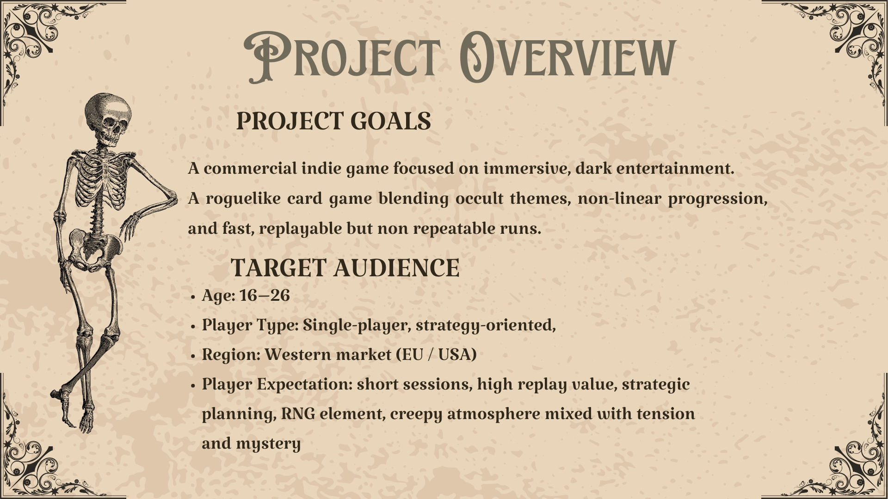
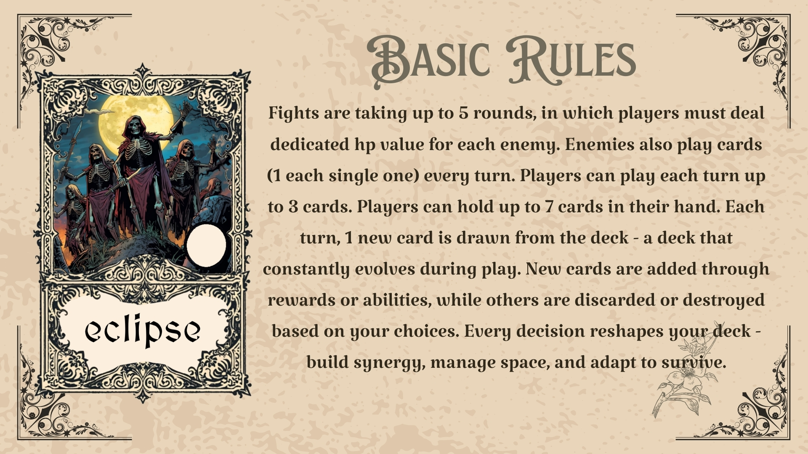
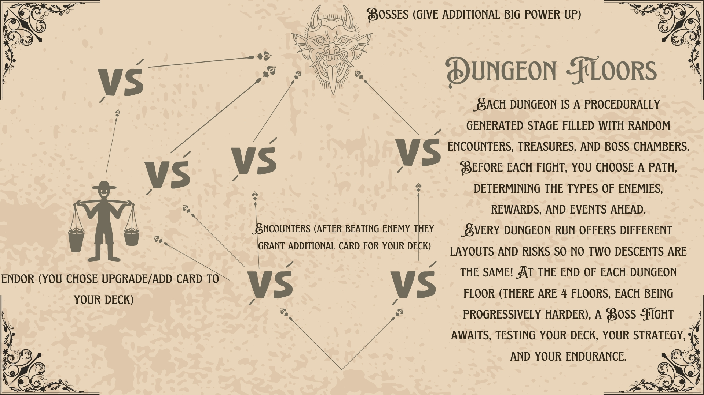
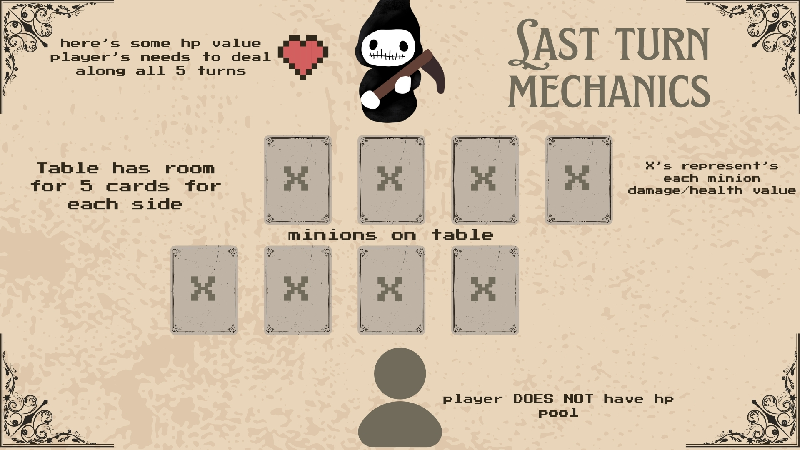
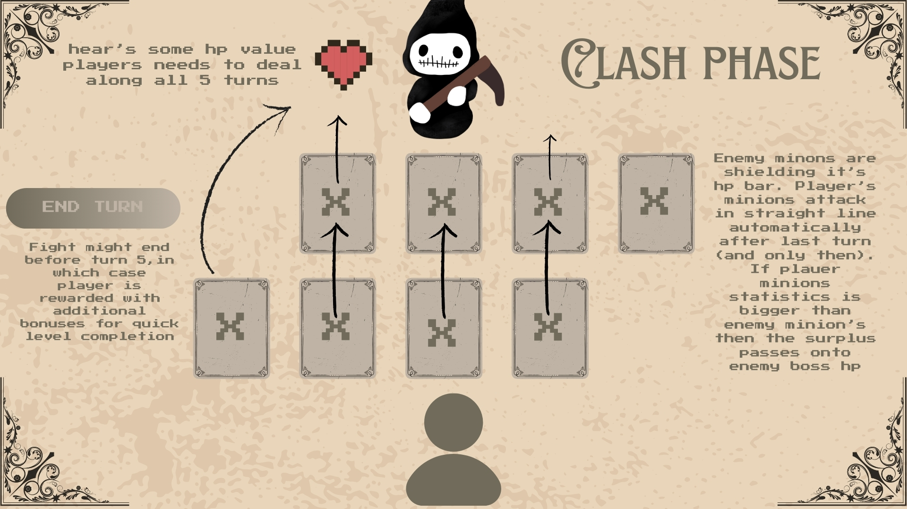
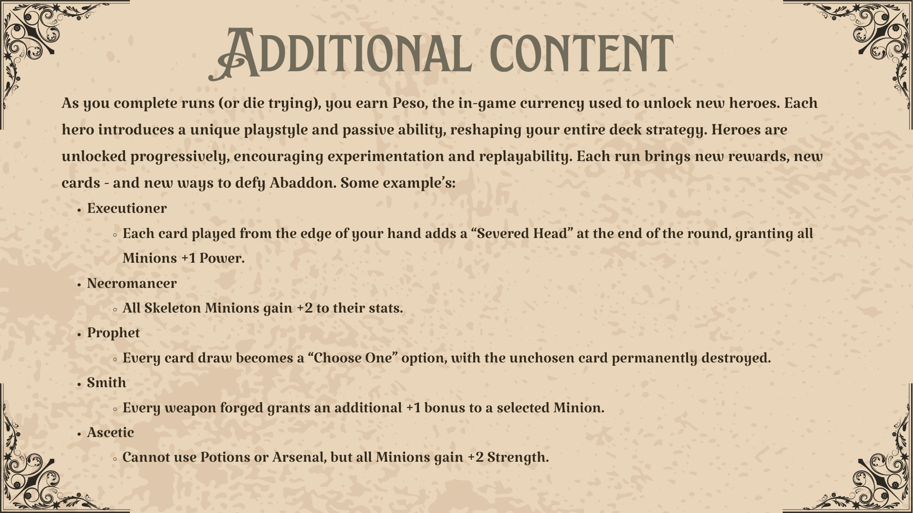

🌑 Reign of Abaddon
A 24-Hour Hackathon Sprint

Reign of Abaddon is a commercial-grade indie project focused on immersive, dark entertainment. Developed in just 24 hours, this roguelike card game was brought to life by Team Gonsior : Franciszek, Dawid, Antoni, Dawid, and Piotr Gąska.

🎯 Project Overview & Goals 

The Vision: A roguelike card game blending occult themes and non-linear progression.

Core Loop: Fast, replayable runs that offer unique challenges every time.

Market Focus: Primarily designed for the Western market (EU / USA).

Target Audience: Players aged 16-26 who enjoy strategy-oriented single-player games.

Atmosphere: Designed to meet player expectations for short, intense sessions filled with tension, mystery, and a "creepy" aesthetic.

⏳ Gameplay: The 5-Turn Survival Mechanic 

In Abaddon, time is your only resource. We stripped away the traditional safety nets to create a "pressure-cooker" combat system.

The Objective: You must deal enough damage to defeat the enemy hero in exactly 5 turns.

High Stakes: Failing to defeat the enemy within the 5-round limit ends the run in immediate defeat.

No Safety Net: The player does not have an HP pool; survival depends entirely on offensive efficiency.

Tactical Drawing: Players draw one new card per turn and can hold up to 7 cards in their hand.

🃏 Tactical Card Archetypes 

The game features four distinct card types, each serving a unique tactical purpose to ensure deep deckbuilding synergy.

Minions: Summoned units that stay on the board for several turns and serve as your main source of offense.

Arsenal: Weapons and relics used to empower Minions with stat boosts or special effects.

Potions: Highly versatile, single-use cards for immediate effects like healing, damage, or altering battlefield conditions.

Fate: Global effects that reshape the entire battlefield, blessing or dooming both sides equally.

🏰 Procedural Descent
Players must descend through Abaddon's shifting dungeons, building their deck to survive each run.

Structure: The descent consists of 4 progressively harder floors.

Procedural Generation: Each stage is procedurally generated and filled with random encounters, treasures, and boss chambers.

Player Choice: Before each fight, you choose a path, determining the rewards and risks ahead.

Boss Fights: Every floor culminates in a boss fight that tests your strategy and deck synergy.

⚔️ Combat & Clash Mechanics 

Board Layout: The battlefield has room for 5 cards on each side.

Action Economy: Players can play up to 3 cards per turn, while enemies play one card.

Shielding: Enemy minions act as a shield for the enemy boss's HP bar.

The Clash: Your minions attack automatically in a straight line after the final turn.

Surplus Damage: If a minion's statistics are higher than the blocker's, the surplus damage hits the enemy boss directly.

🎭 Hero Meta-Progression 

Even in defeat, the run continues to provide value through a permanent unlock system.

Peso Currency: Completing runs (or dying in the process) earns you Peso, used to unlock new heroes.

Unique Playstyles: Each hero introduces a unique passive ability that reshapes your strategy.

The Executioner: Cards played from the edge of the hand grant Minions +1 Power.

The Necromancer: Specifically empowers Skeleton Minions with +2 to their stats.

The Prophet: Changes every draw into a "Choose One" mechanic, permanently destroying the unchosen card.

The Smith: Grants additional bonuses when forging weapon (Arsenal) cards.

The Ascetic: Forfeits the use of Potions and Arsenal in exchange for +2 Strength for all Minions.

🛠️ Summary & Rules 

Engagement: Fights are fast, taking a maximum of 5 rounds.

Deck Evolution: New cards are added through rewards, while others are destroyed based on player choices.

Victory Rewards: Defeating enemies grants additional cards to strengthen your deck for the bosses ahead.

