# ZaWahę – Inteligentny Ekosystem Paliwowy 🚗💨

> **Status projektu:** Koncept UI/UX gotowy do fazy deweloperskiej. Skoncentrowany na optymalizacji kosztów poprzez model UGC (User-Generated Content).

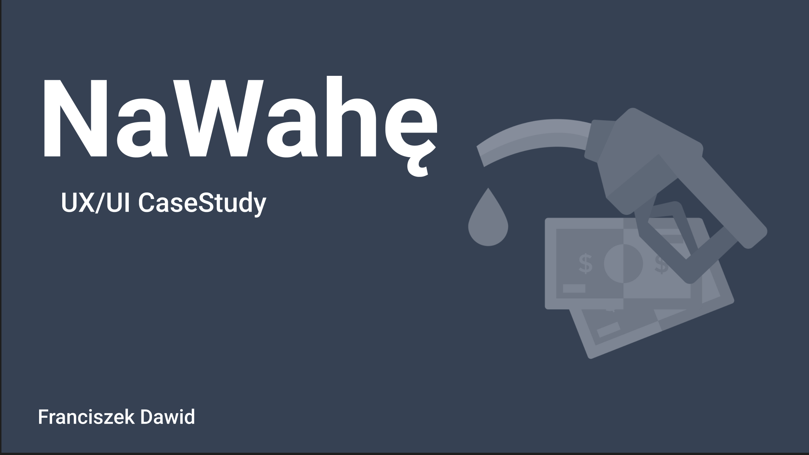

---

## 🎯 Executive Summary
**ZaWahę** to platforma mobilna rozwiązująca problem asymetrii informacji na rynku paliw. Wykorzystując mechanizmy społecznościowe (crowdsourcing), aplikacja dostarcza zweryfikowane dane cenowe w czasie rzeczywistym. Projekt łączy w sobie narzędzie analityczne, nawigację oraz moduł społecznościowy do rozliczania kosztów podróży.

---

## 🧠 Strategia Produktu (Product Thinking)

### Hipoteza biznesowa
Większość aplikacji paliwowych zawodzi z powodu nieaktualnych danych (dynamiczne zmiany cen). Wprowadzenie mechanizmu **„One-Tap Update”** buduje wiarygodność bazy danych i lojalność użytkowników (Retention), przy minimalnym wysiłku poznawczym kierowcy.

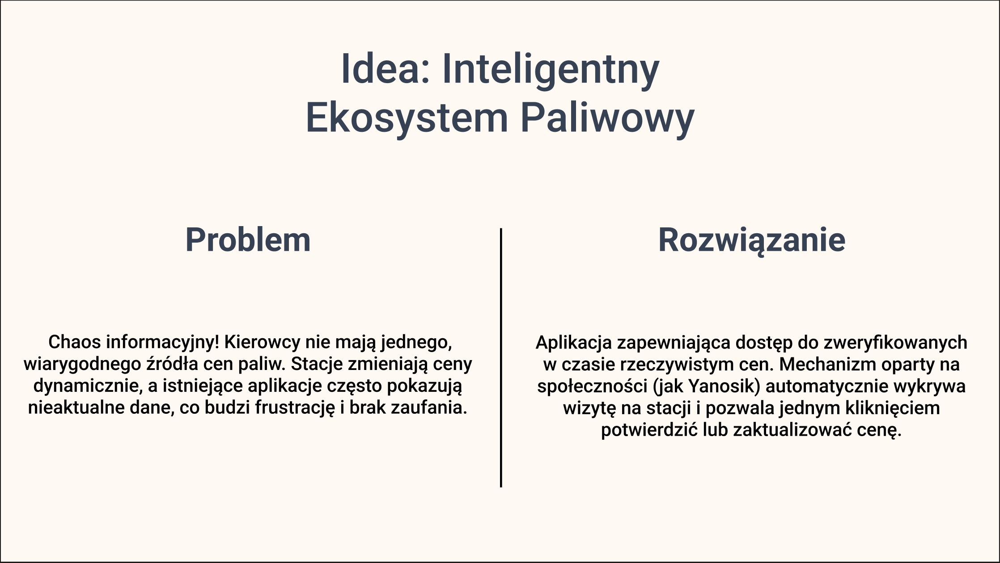

### Kluczowe wyróżniki (USP):
* **Smart Reporting:** Inteligentne wykrywanie wizyty na stacji poprzez geofencing.
* **Social Billing:** Unikalny system podziału rachunków za paliwo zintegrowany z trasą.
* **Economic Route Optimization:** Algorytm wskazujący punkty tankowania generujące największe oszczędności na trasie.

---

## 👥 User Experience & Research

### Persona: Michał (41 lat) – Power User
Michał to specjalista ds. sprzedaży, spędzający 70% czasu pracy w trasie.
* **Potrzeba:** Rozwiązanie "set and forget". Każda sekunda spędzona na konfiguracji aplikacji to dla niego strata czasu.
* **Bóle:** Niska wiarygodność danych w obecnych aplikacjach oraz przeładowanie funkcjami reklamowymi.

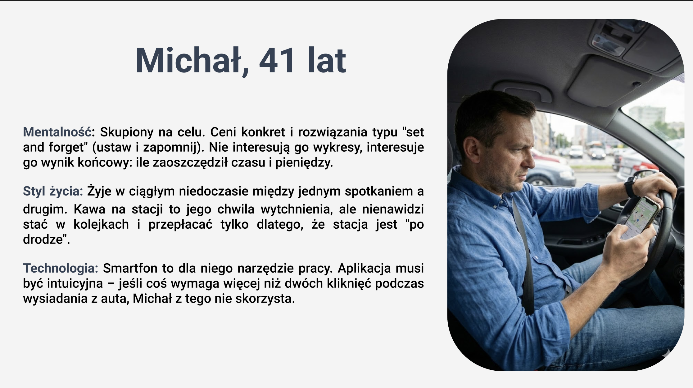

---

## 📱 Core App Experience
Poniższy grid prezentuje kluczowe ścieżki użytkownika (User Flows) zaimplementowane w wysokiej jakości interfejsie mobilnym.

| Onboarding & Login | Live Navigation | Market Overview |
| :---: | :---: | :---: |
| 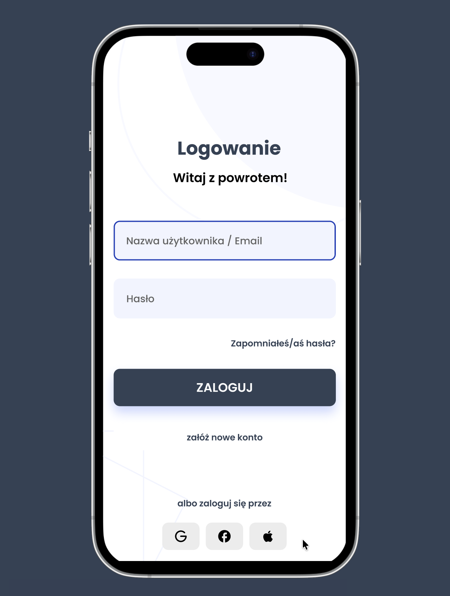 | 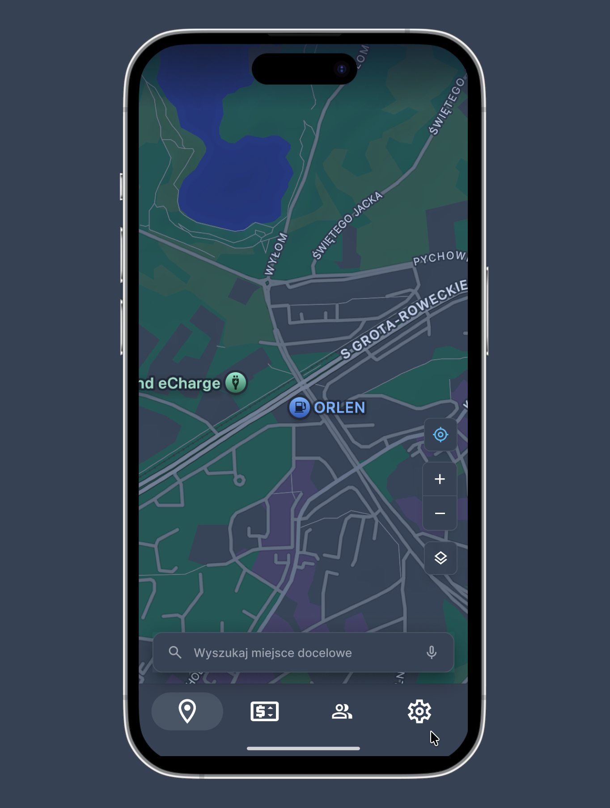 | 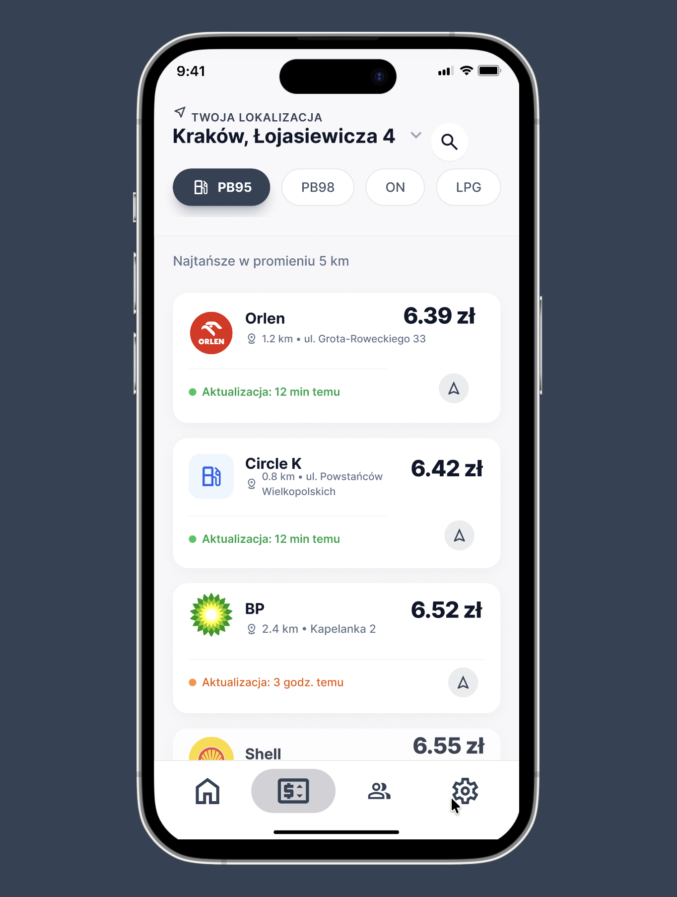 |
| *Przejrzysty proces wejścia.* | *Nawigacja z cenami Live.* | *Ranking stacji w okolicy.* |

| Route Efficiency | Fleet Management | Smart Notifications |
| :---: | :---: | :---: |
| 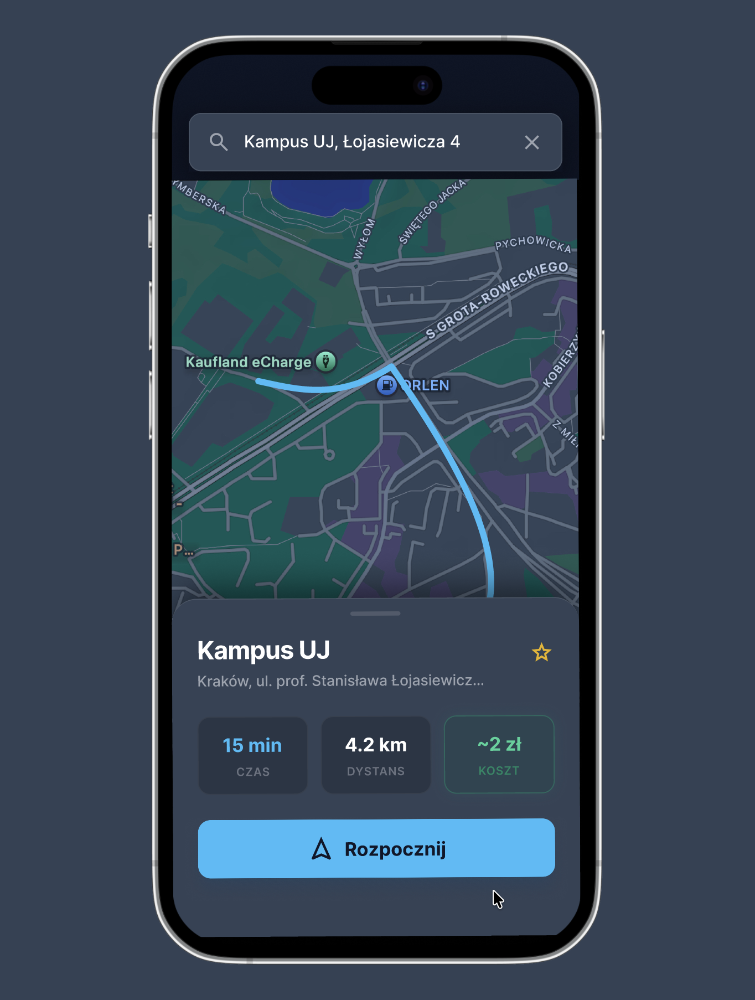 | 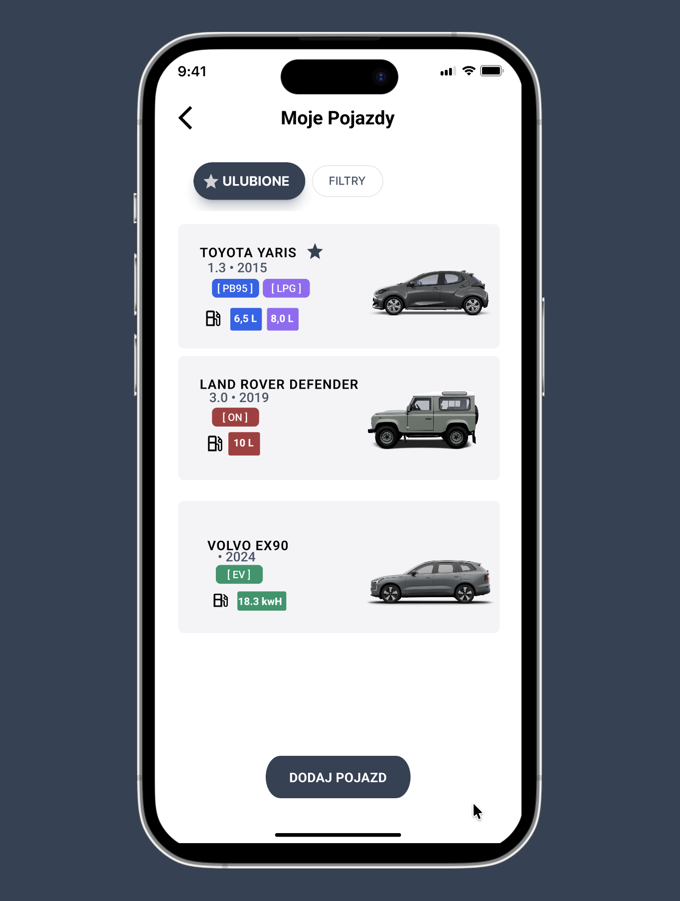 | 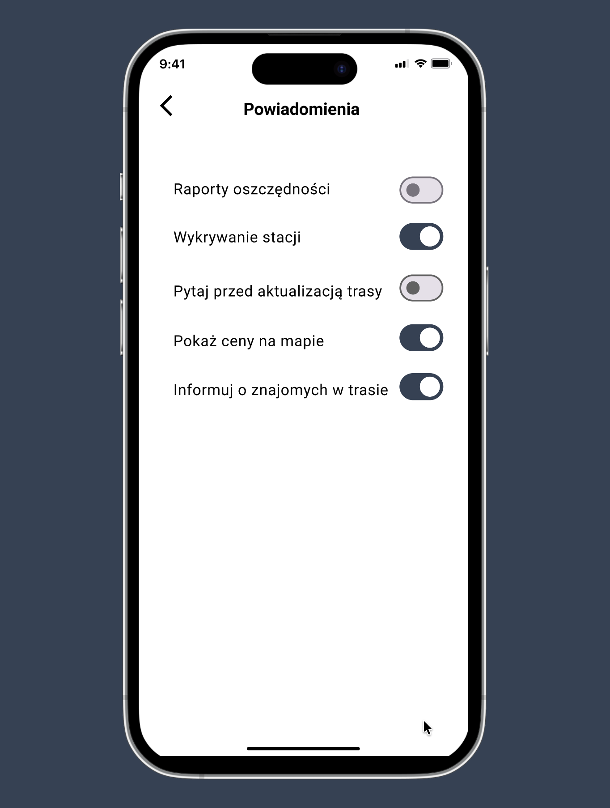 |
| *Analiza kosztów dojazdu.* | *Zarządzanie paliwem i EV.* | *Ustawienia geofencingu.* |

---

## 📐 UX Engineering & Design System

Projekt oparty na metodologii **Atomic Design**, zapewniający pełną skalowalność od atomów (ikony, typografia) po złożone organizmy (karty stacji).

* **Dostępność (WCAG 2.1):** Interfejs zaprojektowany z myślą o czytelności w pełnym słońcu (High-Contrast UI).
* **Dark Mode Strategy:** Dedykowany tryb mapy redukujący zmęczenie wzroku (Eye Strain) podczas jazdy nocnej.
* **EV Readiness:** Gotowość na obsługę infrastruktury ładowania aut elektrycznych (monitoring kWh).

| UI Principles | Visual Identity | Social Interaction |
| :---: | :---: | :---: |
| 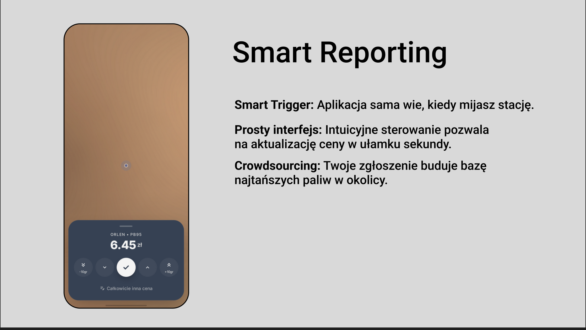 | 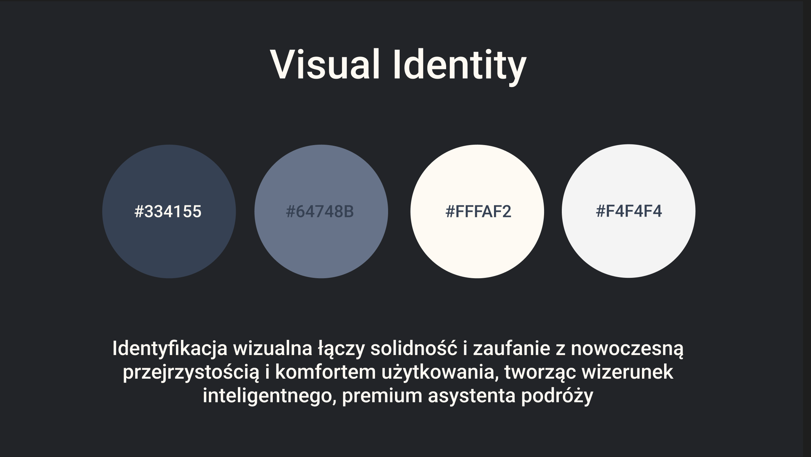 | 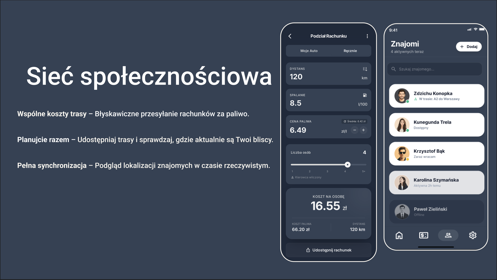 |

---

## 🚀 Technical Handoff & Implementacja
Projekt przygotowany do płynnego przekazania zespołowi deweloperskiemu:
* **Assets:** Wektorowe ikony (SVG) i optymalizowane rastry (@3x).
* **Logic:** Rozbudowana logika stanów dla różnych typów napędów (PB, ON, LPG, EV).
* **Prototyping:** Zaawansowane przejścia (Smart Animate) symulujące realne zachowanie aplikacji.

---

## 🛠 Toolstack
`Figma (Advanced Prototyping)` `Variables` `Auto-Layout 5.0` `Design Tokens` `Adobe Suite`

---

## 👨‍💻 Autor
**Franciszek Dawid**
*UI/UX Designer & Product Strategist*
[Profil Figma](https://www.figma.com/@franda) | [Portfolio LinkedIn](#)

